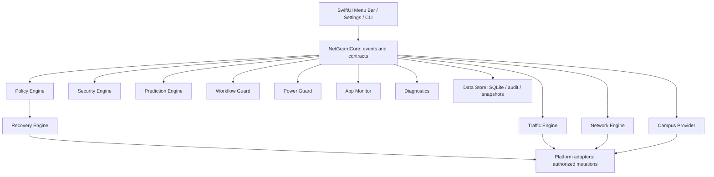

# NCHU-NetGuard — R4.0–R6.0 發展藍圖

> Status: Proposed engineering roadmap | 2026-11-25
> Baseline: 3.0 (Info.plist), commit 46b6ae37cec6de2039479bdec035cae7f80403a8.
> All milestones below are planned; none is marked complete solely by this document.

## 1. Vision and scope

**Local-first Network Intelligence, Automation & Protection for macOS.**

由興大宿網流量監控工具演進為 macOS 原生智慧網路管理平台；NCHU 為第一個校園 Provider，未來支援其他校園、家庭網路、個人熱點與開發者環境。原則：本機優先、預設無遙測、最小權限、可解釋自動化、可逆操作、遵守網路政策。不規避校方限制、不掃描其他使用者、不宣稱能保證既有連線不中斷；只有使用者授權的網路與操作才可納入管理。

## 2. Baseline audit and priorities

目前原始碼：src/main.swift 約 2,605 行、popover.html 約 1,463 行、Python CLI 約 285 行。以下為靜態閱讀發現，非已重現的實機缺陷。

| ID | Priority | Finding / required remediation |
|---|---|---|
| NG-001 | P0 | Swift InsecureCertDelegate 與 Python 停用 TLS 驗證；恢復標準信任驗證，憑證錯誤顯示未知，不允許 silent fallback |
| NG-002 | P0 | 流量計數集中於 activeInterface；改為獨立實體介面計數，處理重置、溢位、VPN 去重、雙網卡及採樣缺口 |
| NG-003 | P0 | networksetup 操作忽略退出狀態；受控操作、逾時、錯誤分類、驗證實際狀態 |
| NG-004 | P0 | 清除附加路由、變更服務順序未完整保存原設定；操作前快照、交易式回滾、崩潰恢復 |
| NG-005 | P0 | SIGSTOP/SIGKILL 等進程控制可能造成資料損失；預設通知，禁止未授權操作，安全恢復、自動化保護清單 |
| NG-006 | P1 | 個人絕對路徑、固定網卡/IP/閘道；改為動態辨識、bundle 資源及標準目錄 |
| NG-007 | P1 | Swift 呼叫 Python --json，但 CLI 未實作；建立版本化 JSON contract 或 Swift 原生 CLI |
| NG-008 | P1 | 校方榜單/鎖卡解析依賴脆弱 HTML；驗證 HTTP、編碼與格式，精確匹配本機網路身分、快取與過期狀態 |
| NG-009 | P1 | 固定 CDN/IP 網段不能可靠識別應用服務；移除不可信假設，驗證路由、IPv6、DNS、VPN，保留原設定 |
| NG-010 | P1 | 單一巨大 Swift 檔案與 WebView bridge；分層、型別契約、隔離訊息來源、避免不安全 HTML 注入 |
| NG-011 | P2 | README 的 make install 未實作；可移植打包、安裝/解除安裝與驗證 |
| NG-012 | P1 | GB/GiB 及本機換日、校方換日/解封不可混同；以整數 bytes 儲存，依已確認政策解讀 |

校園配額目前文件描述為下載 7 GB、上傳 4 GB；R4.0 必須由官方來源確認適用範圍、計量單位、更新週期與日期，不將未上榜、逾時或解析失敗當成安全。校方統計可能延遲，與本機估計並列顯示；不可假定相加或 max 即等於權威用量。

## 3. Target architecture



Swift 6、Swift Package Manager、SwiftUI/AppKit、Swift Charts、Swift Concurrency/actors、Network.framework、SystemConfiguration、SQLite、SMAppService、OSLog、Swift Testing/XCTest、GitHub Actions。保留 macOS 14+ 目標；API availability、Intel 支援與實機相容性須驗證。Python/HTML 以漸進式遷移與相容層取代，不一次性重寫；Network Extension/System Extension 僅在權限、entitlement、簽章及技術可行性確認後選配。

```text
Package.swift
Apps/NetGuardApp/             Apps/NetGuardCLI/
Sources/NetGuardCore/        Sources/TrafficEngine/
Sources/NetworkEngine/       Sources/PolicyEngine/
Sources/SecurityEngine/      Sources/PredictionEngine/
Sources/WorkflowGuard/       Sources/PowerGuard/
Sources/AppMonitor/          Sources/DataStore/
Sources/Diagnostics/         Sources/RecoveryEngine/
Sources/PlatformAdapters/    Sources/CampusProviders/NCHU/
Tests/UnitTests/             Tests/IntegrationTests/
Tests/RegressionTests/       Tests/PerformanceTests/
Tests/SecurityTests/         Tests/Fixtures/
docs/contracts/              docs/adr/
docs/ARCHITECTURE.md         docs/THREAT_MODEL.md
docs/DEVELOPMENT.md          docs/ROADMAP.md
.github/workflows/           scripts/
AGENTS.md                    SECURITY.md
CONTRIBUTING.md              CHANGELOG.md
```

Target layout only. Legacy src/ and scripts/ remain until compatibility and migration gates pass.

## 4. Twelve capability modules

| Module | Scope and expected outcome |
|---|---|
| Traffic Engine | Per-interface rx/tx bytes, independent baselines, monotonic timing, reset/sleep/hotplug/cross-day handling; uncertainty and virtual interface deduplication |
| Network Engine | Discover service identity, routes, DNS, IPv4/IPv6, VPN; bounded reachability/latency/loss probes, cooldown/hysteresis, verified failover |
| Policy Engine | Deterministic versioned rules, quota/priority/time windows, conflict resolution, explainable reason and dry run |
| Security Engine | Trusted TLS, least privilege, process warnings, origin-checked bridge, no arbitrary command execution, explicit permissions |
| Prediction Engine | Local statistical forecasting, remaining quota/time, anomalies, confidence intervals or unknown when data sparse; no LLM dependency |
| Workflow Guard | Opt-in critical tasks (Codex, ChatGPT, VS Code, Git/SSH, development servers); defer optional disruption, never bypass network policy |
| Power Guard | Distinguish clamshell/external display, system sleep, display sleep and idle; safe resume; no unsolicited media/process control |
| App Monitor | App rates/rankings, attribution confidence, unattributed bucket; precise per-app filtering only if supported/authorized |
| Campus Provider | NCHU official quota/usage/block status; verified source, timestamps, parser fixtures, rate limiting; extensible providers |
| Data Engine | SQLite migrations, minute/hour/day aggregations, 7/30/90/365-day views, CSV export, retention and deletion |
| Diagnostics | Interface/DNS/route/VPN/permission/portal/policy problems; redacted local diagnostics and actionable remediation |
| Recovery Engine | Persist snapshots before mutation, validate outcome, rollback, crash recovery, safe mode, manual restore/uninstall |

## 5. User experience

**Simple operation, powerful engine (操作簡單直觀，底層功能強大).** [UX constitution and acceptance gates](UX-PRINCIPLES.md) are mandatory for all user-facing changes. Default quick panel uses progressive disclosure; advanced controls remain discoverable. Safety, permission, data confidence and error states must not be hidden for visual simplicity.


Menu bar compact status and native main window; six views: Overview (quota and confidence), Analytics (history), Connections (network quality), Applications (traffic and guard), Automation (rules/schedules), Diagnostics (logs/recovery). Support light/dark mode, keyboard navigation, VoiceOver, dynamic text, clear unknown/stale states. Present download/upload budgets separately, show local and provider data freshness, network scope and policy. No misleading success notifications or assurances of guaranteed routing.

## 6. Decision and recovery lifecycle

Observe -> assess risk and quota policy -> evaluate workflow protection -> evaluate authorized fallback -> dry run / consent -> persist pre-action snapshot -> apply serialized allowlisted operation -> verify postconditions (including DNS/IPv6 where applicable) -> commit event or rollback -> verify recovery. Failure or conflicting external changes enter safe mode; never overwrite unrelated settings or continue repeated mutations. Protected workflow delays nonessential action only, cannot override mandatory policy or user consent. Pause automation leaves observation running; network modifications and process control default off until authorized.

Initial configurable examples: 70% quota warning, 85% stronger warning, 95% critical review; all thresholds apply to separate upstream/downstream limits. Network loss must persist across samples; avoid flapping. Probe traffic must be budgeted and disclosed. Portal errors/stale data -> unknown, not safe. Idle guard recommends action rather than kills processes. No fixed gateway, broad IP-range exceptions or invisible quota bypass. Use documented, permissioned fallback interfaces only.

## 7. Version roadmap and release gates

| Milestone | Deliverables | Exit gate |
|---|---|---|
| R4.0 Foundation | Security and portability fixes; package, contracts, ADR, threat model, fixtures, CI, migration scaffolding | P0 hazards eliminated or disabled by default; deterministic tests; legacy build retained; contract unlock gate satisfied |
| R4.1 Traffic Intelligence | Multi-interface counters, persisted samples, quota reconciliation, history migration | Synthetic counter and time-edge fixtures pass; controlled traffic error target measured |
| R4.2 Network Orchestration | Discovery, quality scoring, serialized switching, rollback and diagnostics | Dry-run/injected failure tests and real authorized dual-interface validation; no unintended route loss |
| R4.3 Native Experience | SwiftUI menu bar, settings, charts, accessibility | UX-01–UX-08 gates, accessibility checks, feature parity, no false state labels |
| R4.4 Automation | Versioned policy, workflow/power guard, forecasts and anomaly alerts | Conflict and permission tests; guarded tasks never automatically terminated; forecast uncertainty surfaced |
| R4.5 Observability | App attribution, history/export, diagnostics, performance | Attribution limits documented; benchmark and data retention checks |
| R5.0 Stable | Integration, installer, recovery/uninstall, long-running validation, documentation | All applicable release gates and real-device validation pass; signing/distribution separate approval |
| R6.0 Universal | Additional providers, custom policies, optional extensions/integrations | Provider contract tests; entitlement/signing/privacy gates; new capabilities opt-in |

No deadlines or implementation completion implied. CI evidence and hardware evidence must be reported separately.

## 8. Multi-agent governance and contract-first unlock

| Owner | Responsibility |
|---|---|
| Agent 0 | Architecture, ADRs, schemas, dependency and contract arbitration |
| Agent 1 | Traffic Engine, sample accuracy |
| Agent 2 | Network Engine, route observation and orchestration |
| Agent 3 | Security, authorization, recovery |
| Agent 4 | Native UI and accessibility |
| Agent 5 | Policy and prediction |
| Agent 6 | Workflow Guard and Power Guard |
| Agent 7 | DataStore, Campus Provider, CLI |
| Agent 8 | QA, CI, performance and integration |

Required versioned contracts before broad parallel implementation:
TrafficSnapshot (interface identity, rx/tx bytes, timestamps, source/quality); NetworkSnapshot (interfaces/routes/reachability); QuotaProfile (scope, limits in bytes, reset and policy source); PolicyDecision (reason, priority, authorization requirement); NetworkAction (allowlisted operation and pre/postconditions); RecoverySnapshot (original state, ownership, transaction ID); ProtectedWorkflow (identity, lifecycle, opt-in and expiry); EventRecord (schema version, time, reason, outcome, redaction). Define typed errors, version evolution, invariants, fixtures, unknown/stale semantics and ownership. Additional interfaces introduced via ADR.

Unlock requires: reviewed contracts and golden fixtures; dependency direction with no UI-owned business logic; build/test CI green; independent branches with path ownership; mock adapters and no real system mutation in CI; integration branch and compatibility tests; change requests for shared contracts; one accountable integrator. Until unlocked, limit parallel work to isolated docs, tests/fixtures, and nonoverlapping safe fixes. No agent may claim another module complete without evidence.

## 9. Quality and release verification

| Dimension | Weight |
|---|---:|
| Core completeness | 20 |
| Stability and recovery | 20 |
| Security and privacy | 15 |
| Tests/CI | 15 |
| Architecture | 10 |
| UX | 10 |
| Performance/energy | 5 |
| Documentation/portability | 5 |

Proposed measurable targets (not current results): zero open P0/P1, core line coverage >=90%, controlled interface byte-count error <=1% (same measurement boundary, known overhead), idle average CPU <=0.5%, idle RAM <=80 MB, panel opening <=300 ms, defined link-failure detection <=5 s, 100% of enumerated rollback/failure-injection cases verified, 168-hour soak, all registered regressions pass, zero unnecessary telemetry and unauthorized process termination. Hardware, OS, sampling window and baseline must accompany metrics. Record limitations; do not optimize by hiding failures or fabricating missing evidence.

Required scenarios: sleep/wake, midnight/time zone changes, counter reset/wrap, multiple NICs, VPN/IPv6, offline/portal/TLS failure, stale or malformed provider data, denied privileges, command failures/timeouts, interruption/crash during change, manual network changes, protected workflows, data migration, fresh install/uninstall, low-energy and accessibility checks. MacBook Air M4 is primary real-device target; Intel/older OS claims remain unverified until tested.

## 10. First implementation backlog — R4.0

- [ ] Establish architecture/ADR, threat model, AGENTS.md and development rules.
- [ ] Define contracts, versioning, ownership, test fixtures and parallel unlock gate.
- [ ] Restore standard TLS validation and unknown states.
- [ ] Prevent unsafe/unapproved process control and route modifications.
- [ ] Remove absolute paths and fixed fallback identities; fix CLI contract and build/install.
- [ ] Introduce Swift package and migration adapter; keep legacy baseline.
- [ ] Implement atomic data persistence and migration plan.
- [ ] Add deterministic tests, macOS CI and static safety checks.
- [ ] Create reproducible performance baseline and capability audit.
- [ ] Document rollback, safe mode, feature flags and real-device validation checklist.

## 11. References and policy

- Current source: [Swift](../src/main.swift), [CLI](../scripts/traffic_monitor.py), [Makefile](../Makefile).
- Campus endpoints in existing source: [Traffic ranking](https://top100.nchu.edu.tw/), [IP block](https://ipblock.nchu.edu.tw/). Confirm official policies before enabling automation.
- Apple: [Network](https://developer.apple.com/documentation/network), [SystemConfiguration](https://developer.apple.com/documentation/systemconfiguration), [Network Extension](https://developer.apple.com/documentation/networkextension), [ServiceManagement](https://developer.apple.com/documentation/servicemanagement).
- Advanced system-level features are conditional; no root daemon by default, no unapproved entitlements, no guaranteed application-level traffic filtering without validated platform support.

Roadmap changes require an ADR or explicit milestone revision. This document does not modify the running application or establish an official university affiliation.
